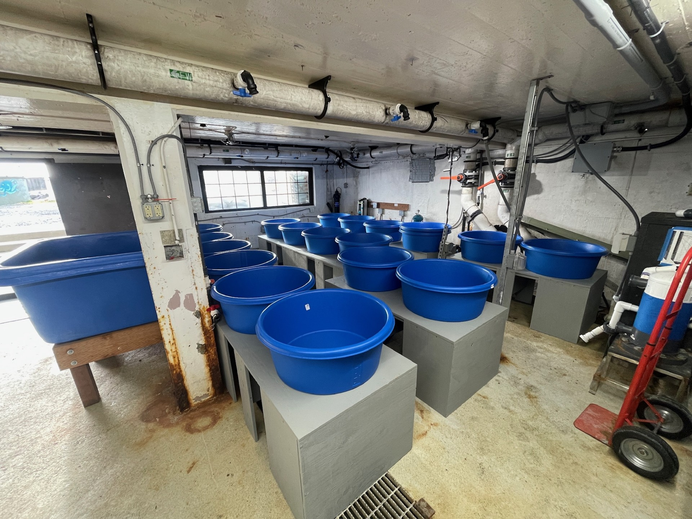

# NPRB_Chinook_Bioenergetics
This repository contains information about the Chinook Bioenergetic project at the Sitka Sound Science Center. The goal of this project is to create a bioenergetic model for juvenile Chinook salmon on the Yukon river. The project is run in collaboration with the Yukon Delta Fisheries Development Association (YDFDA) and NOAA. This repository will be updated as data is available from the experiment. Please reachout with any questions to twilson@sitkascience.org.

## Background/Outline
The Yukon Chinook fishery has seen historical lows for many years, with commercial fishing closing on the river in 2007 and subsistence fisheries being shut down in 2020. The impact on communities along the Yukon and its many tributaries has been swift and severe. There are many factors contributing to the loss in the salmon populations. Some primary concerns are: bycatch, rising temperatures, loss of habitat etc. This project focuses on the changing climate and rising temperatures in the river and how these changes effect juvenile Chinook salmon. Specifically we are building a model to predict survival rates of out-migrating Chinook smolt, based on temperature and the size of the fish during the time period of out-migration.

## Timeline
Data has been collected on the Yukon by YDFDA since 2014 on juvenile salmon and river health. Two trials will be run at the Science Center to build out the bioenergetic model. The first trial will be in October of 2025 and the second will be in May of 2026.

## Lab Space Overview
The lab contains 18 experiment tanks with flow control and air stones to control oxygen saturation. The lab has 6 mixing tanks to heat/chill water to up to 6 different temperatures. The lab is also equipped with full-spectrum UV lights to mimic sunlight for the experiments.

## Equipment Overview
The lab space is designed to change depending on experimental needs so this list might not include all hardware needed depending on the experimental design.
### Pumps Used
There are three steps involving pumps throughout the system:
1. The first is in the hot and cold sump loops, the pumps used are [Pentair's Taurus Variable Speed Pump](https://pentairaes.com/taurus-vs-pump)
2. From the hot and cold sumps to the mixing tanks [Pentair's Sparus Pump](https://pentairaes.com/taurus-vs-pump)
3. Magnetic drive submersible pumps run water from the mixing tanks to experiment tanks. [Pentair's MD9 Mag Drive Pump](https://pentairaes.com/danner-magnetic-drive-pumps)

### Water filtration
All incoming water can be run through filter baskets, currently 300 microns, and all freshwater is treated with UV filtration. Outflow can be treated with UV if need be.

### Full Spectrum Lighting
Lighting in basement provides full spectrum coverage for the wetlab footprint. Lights can be programmed to the desired daylight cycle.
[Mars Hydro Full Spectrum Lights](https://www.amazon.com/MARS-HYDRO-Commercial-Hydroponic-Greenhouse/dp/B07VPF7KKR?pd_rd_w=5i2Zo&content-id=amzn1.sym.f3626488-c5a2-4cac-9b1d-06aacb66c381&pf_rd_p=f3626488-c5a2-4cac-9b1d-06aacb66c381&pf_rd_r=R0SMJ2KHRHJABH0MNFJC&pd_rd_wg=4UIEo&pd_rd_r=87d2dc4a-a4ac-4d8a-bf24-9bfc959acab9&pd_rd_i=B07VPF7KKR&ref_=pd_bap_d_grid_rp_0_5_t&th=1)

### Heaters
The main heating system is a plate heat exchanger connected to the buildings main boiler system. Auxiliary heat is provided by 3x hot tub heaters run in-line on the hot sump heating loop.

### Chillers
The chiller used is an aqualogic chiller

### Plumbing
All plumbing is PVC or CPVC to ensure no adverse reactions to fresh or saltwater. 
### Mixing Valves
Mixing valves control the temperature and flow into the mixing tanks. Mixing valves are from [Haas Manufacturing Company](https://www.hassmfg.com/search.pl/1745426401-51377?keyword=zoom&new_pn=1050)
